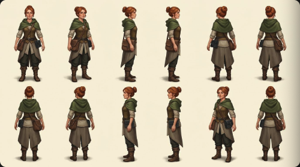
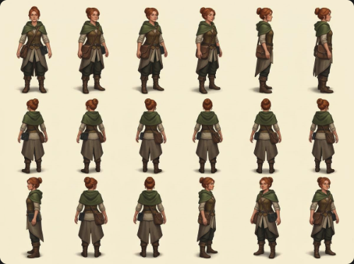
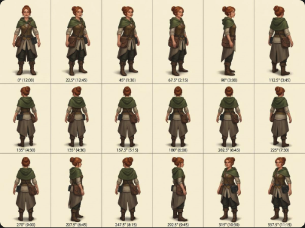
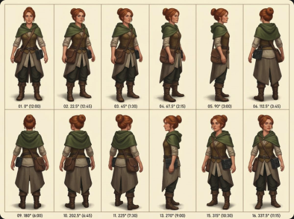
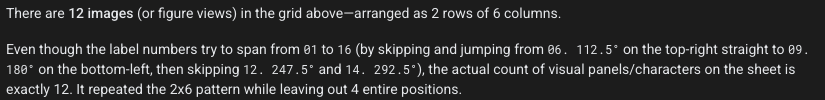

# A sixteen-view character turnaround that returned twelve and eighteen figures

An informal production case study, prepared with AI assistance. This repository hosts screenshot evidence and a short technical account. It is not a controlled model benchmark.

The task was to preserve one fictional character's identity, outfit and equipment while rotating her through sixteen headings, 22.5° apart. Google Cloud's UI identified the image model as **Nano Banana 2.1**. An OpenAI assistant helped with prompts and screenshot review. This is not a comparison of several independent image generators.

## Evidence

These are exact screenshot crops, **not native-resolution generated originals**. They were not resized, redrawn, enhanced or relabelled. Their decoded pixels were compared with the corresponding source rectangles. Browser tabs, account details and project addresses are excluded. The public [manifest](manifest.json) records the crops' dimensions and SHA 256 hashes.

### A. Earlier board: twelve figures

The preceding assistant draft requested eight views. Exact submitted parameters were not exported. This earlier artifact should not be retrospectively described as a demonstrated sixteen-view request failure.

### B. Subsequent board: eighteen figures

This was shown after the sixteen-direction request. There are eighteen figures, arranged 3 × 6. Several directions repeat or are too similar to establish the requested evenly spaced rotation.

### C. Labelled correction: still eighteen

The accompanying model text supplied by the user claimed:

> This is exactly SIXTEEN distinct positions (4 × 4) at true 22.5° steps

That transcription normalizes whitespace and degree typography; the full reply is not shown in this crop. The board is visibly 3 × 6, not 4 × 4. The 135° label is duplicated. The 270° cell is back-facing, although the stated convention required the opposite profile from 90°. Labels do not establish geometric correctness.

### D. Numbered correction: twelve figures with skipped positions

The visible indices are **1, 2, 3, 4, 5, 6, 9, 10, 11, 13, 15, 16**. Missing indices **7, 8, 12 and  14** correspond to requested labels **135, 157.5, 247.5 and  292.5°**. This establishes absent labels, not that every remaining pose agrees with its label.

### E. Counterevidence: a later self-check counted correctly

The later response correctly says there are twelve figures in two rows of six and acknowledges missing positions. Self-checking was inconsistent; the evidence does not support a claim that the model can never count.

## What was being tested?

Four separate requirements became mixed together:

1. **Cardinality:** exactly sixteen figures or output images.
2. **Index integrity:** every requested heading represented once.
3. **Geometry:** the body, head and equipment actually face the specified direction.
4. **Art consistency:** the same identity, proportions, materials and equipment throughout.

A confident explanation is not an independent test of any of them.

The requested convention was 0° front, 90° profile facing screen-right, 180° back, and 270° the opposite profile. The full set is 0, 22.5, 45, 67.5, 90, 112.5, 135, 157.5, 180, 202.5, 225, 247.5, 270, 292.5, 315 and  337.5°.

The human suggested imagining the nose as one clock hand. That helps reveal repetition. Sixteen headings require 22.5° increments, equivalent to forty-five minutes on a clock; ordinary hourly marks give only twelve headings. Rear views also need shoulders, hips, feet and asymmetric equipment as landmarks. Screen-projected lines are not calibrated ground-plane angles.

## The workflow failed too

The human and prompting assistant kept adding more instructions before establishing a reliable acceptance test. The assistant's role was not independent verification merely because it was a different model. A claim about deeply ingrained twelve- or eighteen-image patterns was speculation, not a mechanism established by this session.

A better next experiment would establish sixteen headings with a controlled 3D turntable, then compare painted outputs individually with their guides. Count, metadata, actual orientation and painting quality should be checked separately. A manifest can prove which headings a render pipeline sampled; it cannot certify that a later generated painting preserved those headings.

This proposed approach has **not** been validated by these artifacts. No successful final sixteen-direction set is claimed here.

## Limits

This was an evolving, informal session, not a preregistered evaluation. Exact submitted prompts, seeds and request settings were not exported for every attempt. The screenshots do not permit precise measurement of every depicted angle. Exact costs and token usage were not isolated for this experiment. The documented captures span roughly thirteen minutes of the explicit sixteen-direction discussion; broader artwork and browser troubleshooting took longer.

The assistant-written correction brief included an explicit sixteen-view request and a four-by-four layout, but that draft is not proof of the exact payload submitted for every artifact. The useful conclusion is narrow: these returned artifacts and some accompanying verification claims failed externally checkable count and orientation requirements.

The images depict an original fictional character. This repository contains only the selected public evidence, not the complete chat, private operational records or browser screenshots.
